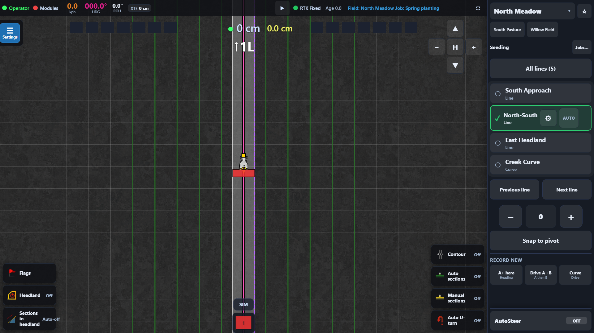
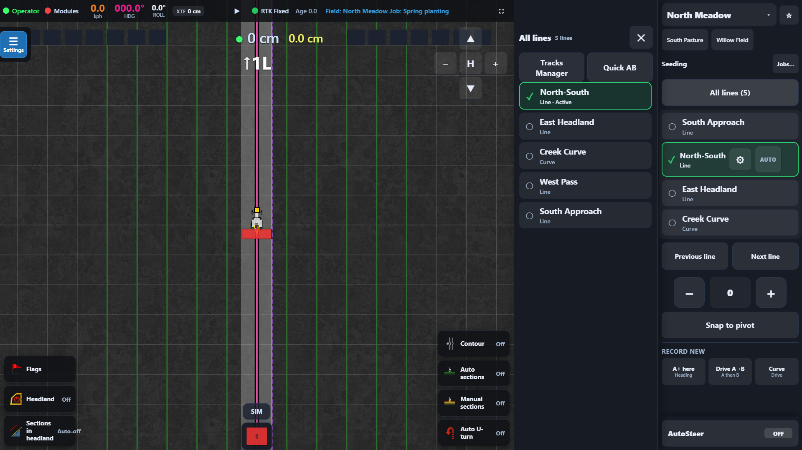

# AgOpenWeb Modern UI

An optional, touch-oriented interface for [AgOpenWeb](https://github.com/AgOpenGPS-Official/AgOpenWeb).
It uses the same guidance backend and existing controls; **Classic remains the default**.

> **Preview:** Modern is still under development and has not completed full parity or real-device
> safety validation. Keep Classic available and use simulator or bench safeguards when testing.

## Screenshots

Modern guidance view:



Expanded **All lines**:



These are real application screenshots using the simulator and fictional fields and lines. They
are not evidence of real hardware operation. See the [regeneration instructions](Docs/MODERN_UI_DEVELOPMENT.md#regenerating-screenshots).

## Try it

On Windows, run `run.cmd modern` from the repository. On other desktop platforms, with the .NET 10
SDK installed:

```bash
dotnet run --project Platforms/AgOpenWeb.Desktop -p:DesktopOnly=true -- --headless
```

Open **http://localhost:5174/?ui=modern**, or choose **Modern UI** under the Classic File / Application
Menu → User Interface. To return to Classic, use **http://localhost:5174/?ui=classic** or choose
**Classic UI** in Settings. The choice is saved per browser. Switching reloads the page and can
release control, turning off AutoSteer and sections.

## What is in the preview

- A right-hand rail for fields, jobs, guidance lines, recording, nudge and AutoSteer.
- An **All lines** column, with access to the existing Tracks Manager and Quick AB tools.
- A labeled **Settings** hub and optional on-map controls that reuse the existing application.
- An optional per-browser **Auto** UI size in Screen & Alerts; manual size presets remain available.

## Important limitations

- Selecting a named line while AutoSteer is engaged asks for confirmation, but the existing select
  command **does not disengage AutoSteer**. Previous/Next use the host's cycle behavior instead.
- Switching fields can discard an unsaved recording. The client cannot always detect a recording
  owned by the host after a reload or reconnect.
- The recording card describes this browser's local flow; it is not authoritative after reconnect.
  The original Tracks Manager and Quick AB retain their Classic command and confirmation behavior.

See the [host-change backlog](Plans/MODERN_UI_HOST_CHANGES.md) for the unresolved safety and
state-projection work.

## Development and downloads

- [Development rules, test gates, screenshot regeneration and upstream ledger](Docs/MODERN_UI_DEVELOPMENT.md)
- [Implementation plan and checkpoints](Plans/MODERN_UI_IMPLEMENTATION_PLAN.md)
- [Build instructions](BUILD.md) and [contributing guide](CONTRIBUTING.md)

The upstream [beta downloads](https://github.com/AgOpenGPS-Official/AgOpenWeb/releases/tag/beta)
are **not builds of this fork**.

## License

[Apache License 2.0](LICENSE.md)
